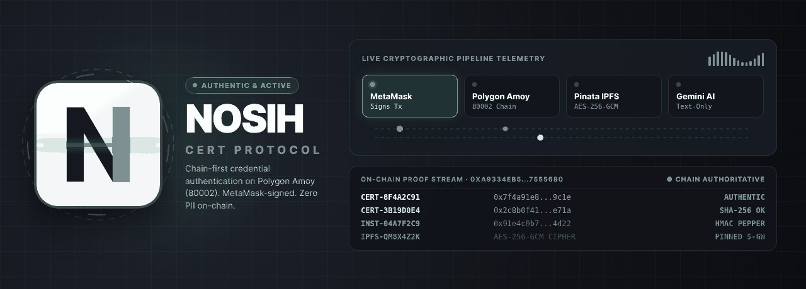
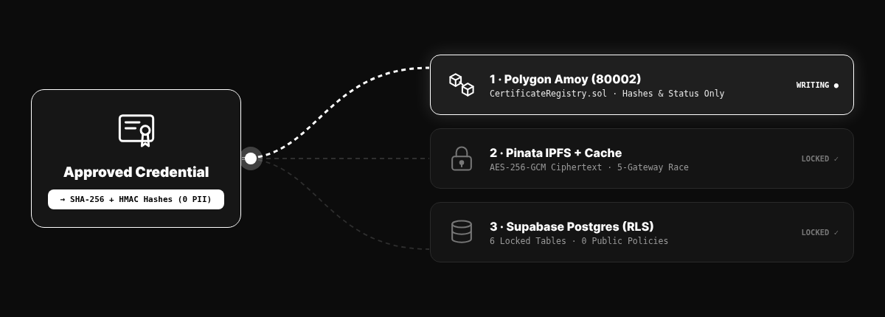
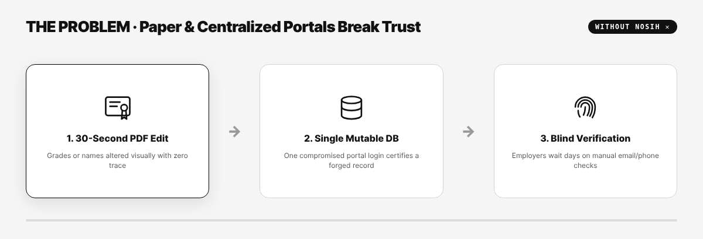
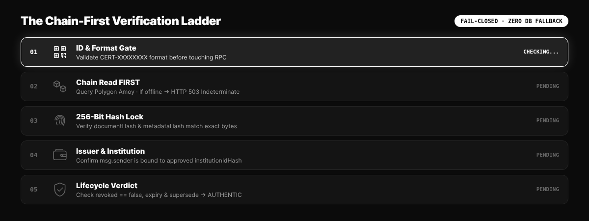
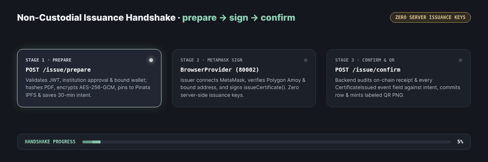
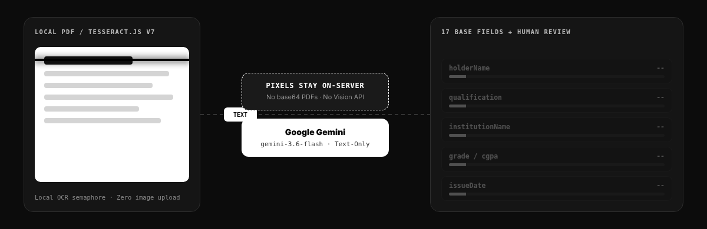
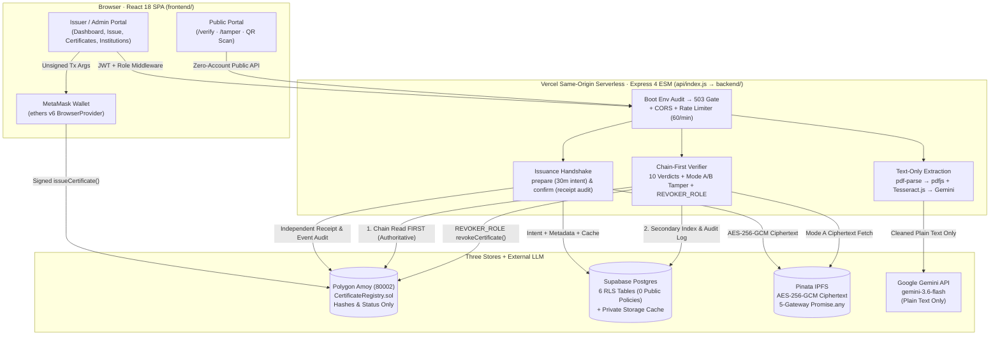
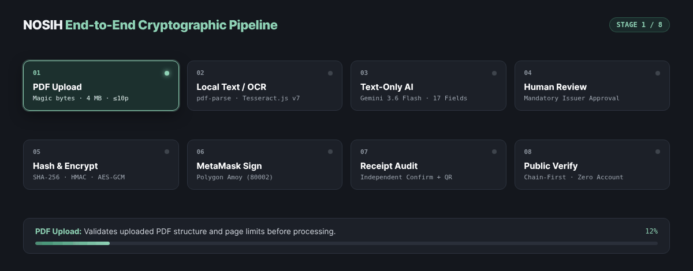
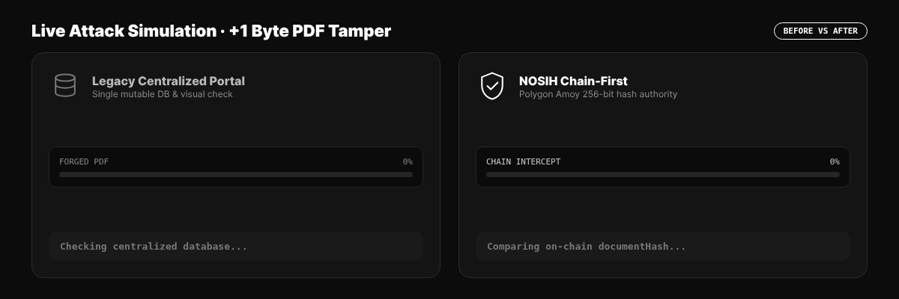
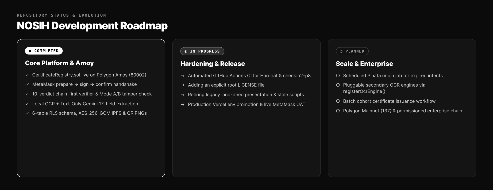

<div align="center">

<a name="readme-top"></a>


# NOSIH


<p>
  
  
  
  
  
  
  
</p>

<p>
  <a href="#02-what-is-nosih">Overview</a> ·
  <a href="#03-the-problem">The Problem</a> ·
  <a href="#04-our-approach">Verification Ladder</a> ·
  <a href="#05-key-features">Features</a> ·
  <a href="#06-system-architecture">Architecture</a> ·
  <a href="#07-how-it-works">Pipeline</a> ·
  <a href="#08-technology-stack">Stack</a> ·
  <a href="#10-installation-and-setup">Install</a> ·
  <a href="#13-performance-testing-and-verification-gates">Commands &amp; Gates</a> ·
  <a href="#15-roadmap">Roadmap</a> ·
  <a href="#18-faq">FAQ</a>
</p>

<br />



<br />

### **Years of study. One degree. One forged PDF can fake it in thirty seconds.**
### **NOSIH makes it mathematically impossible.**

`0 PII on-chain` · `1-byte tamper detection` · `10 chain-first verdicts` · `0 server issuance keys` · `zero-account public verify`

</div>

<br />

<details>
<summary><strong>Table of Contents</strong> — Click to jump to any section</summary>

1. [What Is NOSIH?](#02-what-is-nosih)
2. [The Problem](#03-the-problem)
3. [Our Approach &amp; The Verification Ladder](#04-our-approach)
4. [Key Implemented Features](#05-key-features)
5. [System Architecture](#06-system-architecture)
6. [How It Works — End-to-End Pipeline](#07-how-it-works)
7. [Technology Stack](#08-technology-stack)
8. [Project Structure](#09-project-structure)
9. [Installation and Setup](#10-installation-and-setup)
10. [Usage Guide &amp; API Surface](#11-usage-guide)
11. [Visual Demonstration](#12-visual-demonstration)
12. [Performance, Testing &amp; Verification Gates](#13-performance-testing-and-verification-gates)
13. [Before vs. After](#14-before-vs-after)
14. [Roadmap &amp; Milestones](#15-roadmap)
15. [Research, Architecture Docs &amp; References](#16-research-and-references)
16. [Known Limitations](#17-limitations)
17. [Frequently Asked Questions](#18-faq)
18. [Contributing](#19-contributing)
19. [License](#20-license)
20. [Acknowledgements](#21-acknowledgements)

</details>

<p align="center"></p>

## 02. What Is NOSIH?

**NOSIH** is a decentralized certificate authentication platform for academic and professional credentials. Institutions issue tamper-evident certificates signed directly from their own **MetaMask** wallet onto **Polygon Amoy (`chainId: 80002`)**; anyone — employers, universities, licensing boards, or students — verifies them in seconds with **no account required**.

The rule is simple: **the blockchain is the authority.** A certificate is authentic only when its on-chain record in `CertificateRegistry.sol` matches the approved document bytes and canonical metadata, its issuer wallet is bound to an approved institution, and the record is neither revoked nor expired.

<div align="center">
  
</div>

### Verified Architecture Scorecard

| Metric | Verified Value | Source in Repository |
| :--- | :--- | :--- |
| **On-Chain PII Fields** | **0** (hashes, encrypted CID &amp; lifecycle flags only) | `contracts/CertificateRegistry.sol` |
| **Server-Side Issuance Keys** | **0** (MetaMask-only `BrowserProvider` signing) | `backend/services/blockchain.js` |
| **Verification Verdicts** | **10** explicit chain-authoritative states | `backend/services/verification.js` |
| **Tamper-Check Modes** | **2** (Mode A stored ciphertext · Mode B PDF upload) | `backend/routes/verify.js` |
| **AI Extraction Schema** | **17** base fields + **10** category templates (text-only) | `backend/services/certificateTemplates.js` |
| **RLS-Locked Tables** | **6** Postgres tables (`0` public policies) | `backend/supabase/schema.sql` |
| **Verification Test Suites** | **3** Hardhat suites + **17** local npm gates | `test/` &amp; `package.json` |
| **Deployed Testnet Contract** | `0xA9334Eb5E1c2811dcAE32880702092a7A7555680` | `deployments/amoy.json` (Amoy `80002`) |

<p align="center"></p>

## 03. The Problem

<div align="center">
  
</div>

- **Visual Forgery Leaves Zero Trace**: Paper seals and digital PDFs can be edited in seconds without any visual clue for an employer or admissions officer.
- **Centralized Portals Trust One Login**: A single compromised admin account or silently altered database row turns a fake credential into a "verified" one.
- **Server-Side Keys Break Custody**: Platforms storing an `ISSUER_PRIVATE_KEY` on a backend server allow a single server breach to forge credentials for any institution.
- **Naive Blockchain Leaks PII**: Putting student names, roll numbers, or raw PDFs on-chain or public IPFS permanently exposes personal data.
- **Vision LLMs Leak Documents**: Sending raw certificate images or base64 PDFs to external AI APIs pushes sensitive identity records outside the institution's boundary.

<p align="center"></p>

## 04. Our Approach

Before NOSIH ever calls a certificate authentic, it climbs a **fail-closed, chain-first verification ladder**. If the blockchain cannot be reached, NOSIH refuses to guess and returns `HTTP 503` (`blockchain-unavailable`) — never "valid from the database alone."

<div align="center">
  
</div>

### Three Stores · Three Hash Families · Zero Shortcuts

- **Polygon Amoy (`CertificateRegistry.sol`)**: Holds only keyed hashes, document/metadata SHA-256 hashes, encrypted `ipfsCID`, bound issuer address, timestamps, `revoked` flag, and `supersedesCertificateIdHash`.
- **Pinata IPFS + Supabase Private Storage**: Stores **AES-256-GCM ciphertext only**. Reads hit the private `certificates` bucket first and fall back to a 5-gateway `Promise.any` IPFS race with background backfill.
- **Supabase Postgres (RLS ON, 0 Public Policies)**: Stores institutions, users, bound wallets, approved metadata, 30-minute issuance intents, and private revocation reasons — accessible only via the backend's `SUPABASE_SERVICE_ROLE_KEY`.
- **Three Hash Families**: `HMAC-SHA256` with server-side `HASH_PEPPER` (holder, institution, revocation reason), `keccak256` (random `CERT-XXXXXXXX` / `INST-XXXXXXXX` IDs), and `SHA-256` (exact PDF bytes &amp; canonical JSON).

### Implementation Status Transparency

| Status | Scope in This Repository |
| :--- | :--- |
| **Implemented &amp; Verified** | `CertificateRegistry.sol` (deployed on Polygon Amoy), MetaMask `prepare → sign → confirm` handshake, 10-verdict chain-first public verifier, Mode A &amp; Mode B tamper checks, text-only PDF/OCR → Gemini extraction, 6-table RLS schema &amp; additive migration, 5-tier RBAC, revocation &amp; supersede reissuance, QR PNG generation, Vercel same-origin wiring, 3 Hardhat suites, and `check:p2`–`check:p8` gates. |
| **In Progress / Operational** | Automated GitHub Actions CI workflows, adding an explicit root `LICENSE` file, retiring legacy land-deed presentation/helper scripts (`verify-deployment-ready.mjs`), and live production Vercel promotion. |
| **Planned** | Scheduled Pinata unpin job for expired/abandoned issuance intents, pluggable secondary OCR engines via `registerOcrEngine()`, batch cohort issuance, and Polygon Mainnet (`137`) / enterprise permissioned chain rollout. |

<p align="center"></p>

## 05. Key Features

<div align="center">
  
</div>

### 1. MetaMask-Only Issuance Handshake (`prepare → sign → confirm`)

<div align="center">
  
</div>

- `POST /api/certificates/issue/prepare` validates JWT auth, institution approval, active bound wallet, PDF magic bytes/size/page cap, and duplicate guards, then hashes, encrypts (`AES-256-GCM`), pins to Pinata IPFS, and stores a 30-minute `issuance_intents` row.
- The issuer signs `issueCertificate(...)` directly in MetaMask (`ethers` v6 `BrowserProvider`). `POST /api/certificates/issue/confirm` independently verifies the on-chain receipt (`status === 1`, `to === CONTRACT_ADDRESS`, `chainId === 80002`) and every `CertificateIssued` event field before committing the authoritative record (idempotent &amp; retry-safe).

### 2. Privacy-First Text-Only AI Extraction

<div align="center">
  
</div>

- `pdfParser.js` extracts embedded text first (`PDF_TEXT_MIN_CHARS = 200`, `MAX_PDF_PAGES = 10`). Scanned pages render via `pdfjs-dist` + `pdf-to-png-converter` + `sharp` and run local `Tesseract.js v7` OCR behind a concurrency semaphore.
- `gemini.js` accepts **strings only** — images and base64 PDFs cannot leave the server even by accident. A human must review and approve every extracted field before hashing or signing.

### 3. Chain-First Verification, Dual-Mode Tamper Check &amp; Role Custody

| Role | Scope &amp; Verified Capabilities |
| :--- | :--- |
| `platform_admin` | Approve, reject, or suspend institutions; manage any institution's staff and issuer wallets; revoke any certificate |
| `institution_admin` | Manage own institution profile, wallets, and staff; issue, revoke, and reissue own institution's certificates |
| `issuer` | Issue and reissue certificates for their own approved institution using their bound MetaMask wallet |
| `auditor` | Read-only access to their own institution's certificates and audit history |
| `public` | Verify any certificate by `CERT-XXXXXXXX` ID or QR code and run Mode A / Mode B tamper checks — zero login |

<p align="center"></p>

## 06. System Architecture

<div align="center">
  
</div>

<details>
<summary><strong>Interactive Mermaid Flow Diagram</strong> — Expand to inspect live component routing</summary>



</details>

<p align="center"></p>

## 07. How It Works

<div align="center">
  
</div>

<details>
<summary><strong>Deep Dive: All 10 Chain-Authoritative Verification Verdicts</strong></summary>

| Verdict Key | Display Label | HTTP Status | Meaning |
| :--- | :--- | :---: | :--- |
| `authentic-active` | Authentic and Active | `200` | On-chain record exists, matches DB &amp; hashes, issuer authorized, not revoked/expired/superseded |
| `revoked` | Certificate Revoked | `200` | On-chain `revoked === true` (always overrides hash match) |
| `expired` | Certificate Expired | `200` | On-chain `expiresAt !== 0 && now > expiresAt` (lazily mirrored to DB) |
| `superseded` | Certificate Superseded (Reissued) | `200` | Replaced by a newer certificate; response includes the replacement `CERT-XXXXXXXX` ID |
| `document-mismatch` | Document Hash Mismatch | `200` | Document hash diverges from the immutable on-chain `documentHash` |
| `metadata-mismatch` | Metadata Mismatch | `200` | Approved metadata hash diverges from on-chain `metadataHash` |
| `issuer-unauthorized` | Issuer Unauthorized | `200` | Issuer wallet or institution binding does not match on-chain authorization |
| `not-found` | Certificate Not Found | `404` | No record found on-chain for the supplied valid `CERT-XXXXXXXX` ID |
| `db-chain-mismatch` | Database/Blockchain Mismatch | `200` | Record exists on-chain but is missing or structurally inconsistent in Supabase |
| `blockchain-unavailable` | Blockchain Unavailable — Indeterminate | `503` | Polygon Amoy RPC unreachable; fails closed and never falls back to DB-only validation |

</details>

<details>
<summary><strong>Deep Dive: 17 Base Extracted Fields &amp; 10 Supported Certificate Categories</strong></summary>

- **17 Base Fields (`backend/services/certificateTemplates.js`)**: `certificateType`, `certificateNumber`, `holderName`, `holderIdentifier`, `institutionName`, `institutionAddress`, `courseName`, `qualification`, `qualificationLevel`, `specialization`, `grade`, `percentage`, `issueDate`, `expiryDate`, `academicYear`, `signatoryName`, `signatoryDesignation`.
- **10 Certificate Categories with Dynamic Extra Templates** (`certificates.extra_data` JSONB): `undergraduate_degree`, `postgraduate_degree`, `diploma`, `transcript`, `professional_training`, `technical_certification`, `course_completion`, `internship`, `achievement`, `other`.

</details>

<p align="center"></p>

## 08. Technology Stack

<div align="center">
  
</div>

<p align="center"></p>

## 09. Project Structure

```text
NOSIH-CERT-main/
├── api/
│   ├── index.js                         # Vercel serverless entry wrapping backend/server.js
│   └── package.json
├── assets/
│   └── readme/                          # Pure-monochrome animated GIFs, SVGs, logo & infographics
├── backend/
│   ├── server.js                        # Express 4 ESM app, /api/health, boot env audit → 503 gate
│   ├── config.js · env.js · envCheck.js # Root .env loader & startup configuration validator
│   ├── supabase.js                      # Service-role Supabase client
│   ├── middleware/                      # auth.js, errorHandler.js, institutionAccess.js, issuerAccess.js
│   ├── routes/                          # auth.js, institutions.js, certificates.js, verify.js
│   ├── services/                        # blockchain, certificateExtraction, certificateIdentity,
│   │                                    # certificateStorage, certificateTemplates, gemini, ipfs,
│   │                                    # ocr, pdfParser, canvasIcu, qr, verification, ABI
│   ├── supabase/
│   │   ├── schema.sql                   # Fresh-install 6-table RLS schema
│   │   └── migrations/001_nosih.sql     # Additive, idempotent migration preserving legacy tables
│   └── scripts/                         # Offline gates (checkP2…checkP9), seedAdmin, smokeP2, fixtures
├── contracts/
│   └── CertificateRegistry.sol          # Solidity 0.8.20 OpenZeppelin AccessControl + ReentrancyGuard
├── deployments/
│   └── amoy.json                        # Deployed Polygon Amoy contract address, txHash & roles
├── frontend/
│   ├── public/                          # index.html, nosih-logo.svg
│   └── src/
│       ├── assets/                      # Official nosih-logo.png & nosih-logo.svg
│       ├── components/                  # WalletConnect, CertificateUpload, CertificatePreview,
│       │                                # VerificationResult, QRDisplay, RevokeModal, TransactionStatus, etc.
│       ├── pages/                       # Login, Dashboard, Issue, Certificates, CertificateDetails,
│       │                                # Institutions, Verify, Tamper + styles.css design tokens
│       ├── services/                    # wallet.js (MetaMask), contract.js
│       └── utils/                       # api.js, certificateHelpers.js, contractABI.js
├── images/badges/                       # Existing SVG status badges
├── plan/                                # Migration plan, architecture, solution design & strategy docs
├── scripts/                             # deploy, addIssuer, removeIssuer, generateAbi, check-*, vercel-*
├── test/                                # CertificateRegistry, IssuanceHandshake & Verification Hardhat suites
├── vercel/                              # Vercel deployment troubleshooting & setup notes
├── hardhat.config.js                    # Solidity 0.8.20, hardhat/localhost/amoy/polygon networks
├── vercel.json                          # Same-origin frontend build + /api/* serverless rewrite
├── .env.example                         # Annotated root environment template
└── package.json                         # Root scripts for contracts, gates & Vercel ops
```

<p align="center"></p>

## 10. Installation and Setup

Prerequisites: **Node.js `22.x`**, Supabase project, Pinata account, Google Gemini API key, and MetaMask with **Polygon Amoy (`80002`)** POL.

```bash
# 1. Install dependencies (root Hardhat, backend API, frontend SPA)
npm install
npm install --prefix backend
npm install --prefix frontend

# 2. Configure environment files
cp .env.example .env
cp frontend/env.example frontend/.env.local

# 3. Apply database schema (fresh: schema.sql · existing NOSIH: migrations/001_nosih.sql)
npm run schema:apply
npm run seed:admin

# 4. Deploy CertificateRegistry & authorize issuer wallet on Polygon Amoy (live write)
npm run deploy:amoy -- --yes
npm run issuer:add -- --yes

# 5. Start local development servers
npm --prefix backend run dev     # API on :5000
npm --prefix frontend start      # React SPA on :3000 (proxies /api)
```

<details>
<summary><strong>Environment Reference &amp; Vercel Deployment Commands</strong></summary>

#### Required at Boot (`backend/envCheck.js`)
| Variable | Purpose |
| :--- | :--- |
| `SUPABASE_URL` | Project URL (`https://<ref>.supabase.co`) |
| `SUPABASE_SERVICE_ROLE_KEY` | Secret service-role key (publishable key cannot read RLS-locked tables) |
| `JWT_SECRET` | Random secret (≥16 chars) signing session JWTs |
| `DOCUMENT_ENC_KEY` | 64-hex-char (32-byte) AES-256-GCM encryption key — **back up securely** |
| `HASH_PEPPER` | 64-hex-char (32-byte) HMAC-SHA256 pepper — **back up securely** |

Feature-gated: `CONTRACT_ADDRESS` (chain reads), `GEMINI_API_KEY` (extraction), `PINATA_JWT` (IPFS pinning), `REVOKE_PRIVATE_KEY` (`REVOKER_ROLE` server-only revocation — no `ISSUER_PRIVATE_KEY` exists).

#### Deploying to Vercel
```bash
vercel login
npm run vercel:env        # pushes backend + build-time REACT_APP_* vars (--dry-run supported)
npm run check:deploy      # preflight: env, live credentials, native-module trace
npm run vercel:deploy
```

</details>

<p align="center"></p>

## 11. Usage Guide

```bash
# Public chain-first verification (zero account)
curl -s https://<your-domain>/api/verify/CERT-8F4A2C91 | jq

# Mode A tamper check (re-hashes stored encrypted IPFS/cache PDF without exposing contents)
curl -s -X POST https://<your-domain>/api/verify/CERT-8F4A2C91/tamper-check | jq

# Mode B tamper check (hashes uploaded PDF bytes directly against on-chain documentHash)
curl -s -X POST https://<your-domain>/api/verify/CERT-8F4A2C91/tamper-check \
  -F "file=@./candidate_degree.pdf" | jq
```

<details>
<summary><strong>Complete Verified REST API Surface</strong></summary>

| Group | Method &amp; Endpoint | Access | Description |
| :--- | :--- | :--- | :--- |
| **Health** | `GET /api/health` | Public | Boot env audit &amp; Supabase readiness (`200` ok / `503` degraded) |
| **Auth** | `POST /api/auth/login` · `POST /api/auth/register` · `GET /me` · `PATCH /me/wallet` | Public / Auth | Login, admin user provisioning &amp; wallet binding |
| **Institutions** | `POST /api/institutions/apply` · `GET /` · `GET /mine` · `PATCH /:id/status` | Public / Admin | Onboarding, approval workflow, wallets &amp; staff |
| **Certificates** | `POST /api/certificates/extract` · `GET /meta/templates` | Issuer / Admin | Text-only PDF/OCR → Gemini extraction &amp; templates |
| **Certificates** | `POST /issue/prepare` · `POST /issue/confirm` · `GET /issue/intents/:id` | Issuer / Admin | Non-custodial MetaMask issuance handshake |
| **Certificates** | `GET /` · `GET /:id` · `GET /:id/document` · `GET /:id/qr` · `POST /:id/revoke` · `POST /:id/reissue` | Role-Scoped | Inspection, decryption, QR PNG, revocation &amp; reissuance |
| **Public Verify** | `GET /api/verify/:id` · `POST /:id/tamper-check` · `GET /:id/qr` | Public (60/min) | Chain-authoritative verification, Mode A/B tamper check &amp; QR |

</details>

<p align="center"></p>

## 12. Visual Demonstration

<div align="center">
  
</div>

### Live Polygon Amoy Testnet Deployment (`deployments/amoy.json`)

| Artifact | Verified Value |
| :--- | :--- |
| **Network** | Polygon Amoy Testnet (`chainId: 80002`) |
| **Contract** | `CertificateRegistry` — [`0xA9334Eb5E1c2811dcAE32880702092a7A7555680`](https://amoy.polygonscan.com/address/0xA9334Eb5E1c2811dcAE32880702092a7A7555680) |
| **Deployment Tx** | [`0x86b5cfb857e10e7347538e5eb24d08149b42b9ea37ba80b5b50b95997d8b3dc8`](https://amoy.polygonscan.com/tx/0x86b5cfb857e10e7347538e5eb24d08149b42b9ea37ba80b5b50b95997d8b3dc8) |
| **Deployed At** | `2026-11-19T05:16:22.365Z` |

<p align="center"></p>

## 13. Performance, Testing and Verification Gates

> **Standing Rule — Zero Live Ledger Writes in Tests:** All contract and integration tests run exclusively on Hardhat's in-memory EVM (`test/CertificateRegistry.test.js` 14 tests · `test/IssuanceHandshake.test.js` 14 tests · `test/Verification.test.js` 16+ tests). No GitHub Actions CI is configured yet; these local gates are the proof.

| Command | Mode | What It Proves |
| :--- | :---: | :--- |
| `npm test` | Offline | Full in-memory Hardhat contract, issuance handshake &amp; 10-verdict verifier suites |
| `npm run check:p2` … `check:p8` | Offline | Schema/authz, extraction, storage/QR, handshake, verification/revocation, frontend contract alignment |
| `npm run check:ui-render` | Offline | Production React bundle renders readable failures in jsdom (never a blank white screen) |
| `npm run check:boot` | Offline | Misconfigured boot stays alive and reports every missing variable via `/api/health` |
| `npm run check:env` / `check:gas` | Live Read-Only | Env audit, key/address derivation, RPC connectivity &amp; wallet POL balances (nothing broadcast) |
| `npm run check:services` | Live Read-Only | Real read-only credential checks against Supabase, Gemini, and Pinata |
| `npm run check:jwt` / `check:ipfs` | Live | Pinata JWT scope audit and 1-byte pin + fetch roundtrip |
| `npm run check:extract` | Live | Real Gemini text-only extraction on digital + scanned certificate fixtures |
| `npm run check:deploy` | Live Preflight | Full Vercel preflight including native-module (`@napi-rs/canvas`, `sharp`, `pdfjs-dist`) file trace |
| `npm run smoke:api` | Live | End-to-end HTTP authorization flow (requires applied migration + seeded admin) |

<p align="center"></p>

## 14. Before vs. After

<div align="center">
  
</div>

| Dimension | Legacy Paper / Centralized Portal | NOSIH Chain-First Architecture |
| :--- | :--- | :--- |
| **Trust Authority** | Single mutable institution database | Polygon Amoy `CertificateRegistry.sol` is authoritative |
| **Signing Custody** | Server-side admin key or paper stamp | MetaMask-only issuer signing · zero server issuance keys |
| **PII Privacy** | Plaintext names &amp; IDs exposed in portal/ledger | Zero PII on-chain · `HMAC-SHA256` + `AES-256-GCM` |
| **Tamper Detection** | Visual inspection misses subtle PDF edits | Mode A &amp; B `SHA-256` catches any 1-byte modification |
| **AI Exposure** | Raw certificate images sent to vision APIs | Local `pdf-parse` / `Tesseract.js` · text-only to Gemini |
| **Outage Behavior** | Silent DB fallback or corrupted state | Fails closed with `HTTP 503` (`blockchain-unavailable`) |

<p align="center"></p>

## 15. Roadmap

<div align="center">
  
</div>

<p align="center"></p>

## 16. Research and References

- [`plan/CERTICHAIN_MIGRATION_PLAN.md`](plan/CERTICHAIN_MIGRATION_PLAN.md) — Engineering decisions D1–D10 and verification phases P0–P9.
- [`plan/TECHNICAL_ARCHITECTURE.md`](plan/TECHNICAL_ARCHITECTURE.md) — Three-tier storage &amp; failure-mode architecture reference.
- [`plan/SOLUTION_DESIGN.md`](plan/SOLUTION_DESIGN.md) &amp; [`plan/PROPOSED_TECHNOLOGIES.md`](plan/PROPOSED_TECHNOLOGIES.md) — Cryptographic design and dependency rationale.
- [`NOSIH_presentation.pdf`](NOSIH_presentation.pdf) — *Historical context*: earlier land-deed prototype that established the three-tier cryptographic, IPFS, and RLS architecture later evolved into NOSIH-CERT.
- Standards: [OpenZeppelin Contracts v5](https://docs.openzeppelin.com/contracts/5.x/access-control) · [Polygon Amoy Docs](https://docs.polygon.technology/) · [Pinata IPFS Docs](https://docs.pinata.cloud/) · [Supabase RLS](https://supabase.com/docs/guides/database/postgres/row-level-security) · [NIST FIPS 180-4 / SP 800-38D](https://csrc.nist.gov/publications).

<p align="center"></p>

## 17. Limitations

- **Testnet Only**: Currently deployed on Polygon Amoy (`80002`); mainnet (`137`) or permissioned enterprise chain deployment requires separate RPC and funding setup.
- **Orphaned Pins on Abandoned Intents**: Ciphertext pinned during `/issue/prepare` remains on Pinata if an issuer cancels MetaMask signing, until a scheduled unpin job is implemented.
- **Read-Time Expiry**: Smart contracts have no native cron; expiry is evaluated at read time and lazily mirrored to Postgres.
- **Serverless &amp; OCR Caps**: Vercel enforces a 4.5 MB body limit (`MAX_UPLOAD_MB = 4`, `MAX_PDF_PAGES = 10`), and local `Tesseract.js` runs behind a single-worker concurrency semaphore.
- **No CI &amp; Legacy Artifacts**: No GitHub Actions workflows exist yet; `NOSIH_presentation.pdf` and stale `verify-deployment-ready.mjs` remain in the repo (`scripts/vercel-preflight.mjs` is active).

<p align="center"></p>

## 18. FAQ

<details>
<summary><strong>Why is there no ISSUER_PRIVATE_KEY on the server?</strong></summary>

Because a server compromise should never be able to forge a degree. Every issuance is signed exclusively by the issuer's MetaMask wallet (`BrowserProvider`).

</details>

<details>
<summary><strong>What happens when the blockchain RPC is down?</strong></summary>

NOSIH fails closed and returns `HTTP 503` (`blockchain-unavailable`). It will never tell an employer a certificate is authentic using only Supabase Postgres.

</details>

<details>
<summary><strong>Does Gemini ever see the certificate PDF or image?</strong></summary>

Never. `backend/services/gemini.js` accepts plain text strings only. Digital PDFs parse via `pdf-parse`, scanned pages OCR locally via `Tesseract.js v7`, and pixels stay inside the server.

</details>

<details>
<summary><strong>How do you fix a typo if the blockchain is immutable?</strong></summary>

You reissue, never overwrite. The new certificate links `supersedesCertificateIdHash` to the old record; verifying the old ID returns `superseded` and points directly to the replacement `CERT-XXXXXXXX`.

</details>

<details>
<summary><strong>What if DOCUMENT_ENC_KEY or HASH_PEPPER is lost?</strong></summary>

Encrypted IPFS PDFs become permanently undecryptable and keyed identity hashes lose linkage. Back up both 64-hex-character secrets securely outside the repository.

</details>

<p align="center"></p>

## 19. Contributing

1. Fork the repository and create a branch (`git checkout -b feat/your-change`).
2. Run the offline verification gates before opening a PR:
   ```bash
   npm test
   npm run check:p2 && npm run check:p4 && npm run check:p5 && npm run check:p6 && npm run check:p7 && npm run check:p8
   ```
3. Never commit `.env` secrets or run live Polygon Amoy writes from automated tests.

<p align="center"></p>

## 20. License

- **Repository Root**: No `LICENSE` file is currently present in the repository root, and `package.json` omits a `"license"` field.
- **Smart Contract**: `contracts/CertificateRegistry.sol` specifies `// SPDX-License-Identifier: MIT`.

<p align="center"></p>

## 21. Acknowledgements

Built on [OpenZeppelin](https://www.openzeppelin.com/), [Hardhat](https://hardhat.org/), [ethers.js](https://docs.ethers.org/), [Polygon](https://polygon.technology/), [Supabase](https://supabase.com/), [Pinata / IPFS](https://www.pinata.cloud/), [Tesseract.js](https://tesseract.projectnaptha.com/), [PDF.js](https://mozilla.github.io/pdf.js/), [Google Gemini](https://ai.google.dev/), [React](https://react.dev/), [Express](https://expressjs.com/), and [Vercel](https://vercel.com/).

<br />

<div align="center">


<br />


**NOSIH** — *Years of effort deserve proof no one can fake.*

<p>
  <a href="#readme-top">Back to Top ↑</a> ·
  <a href="#04-our-approach">Verification Ladder</a> ·
  <a href="#06-system-architecture">Architecture</a> ·
  <a href="#10-installation-and-setup">Install</a> ·
  <a href="#18-faq">FAQ</a>
</p>

</div>