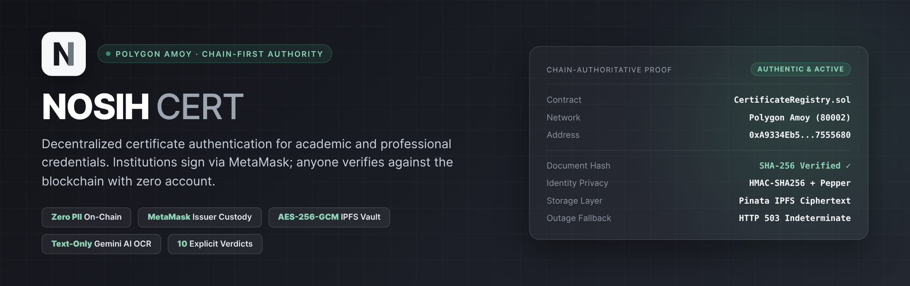
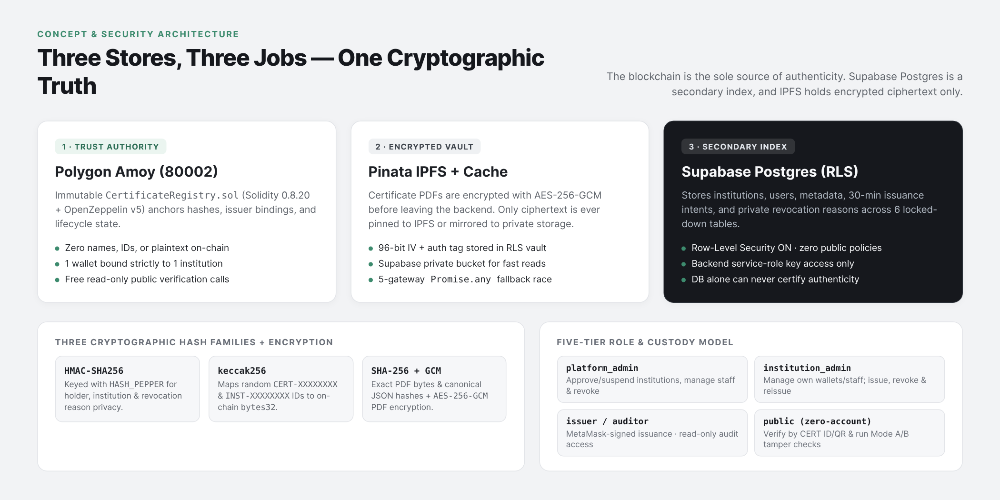
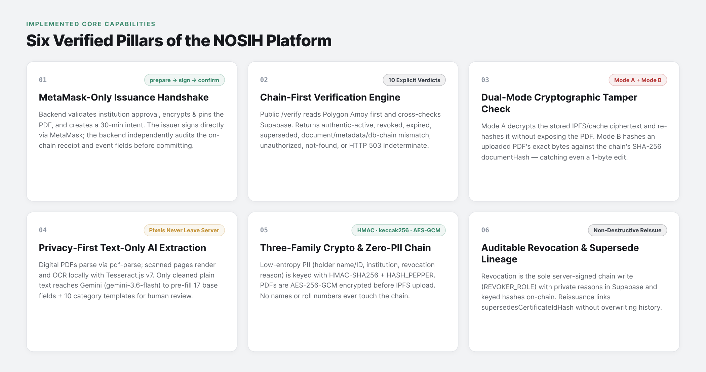
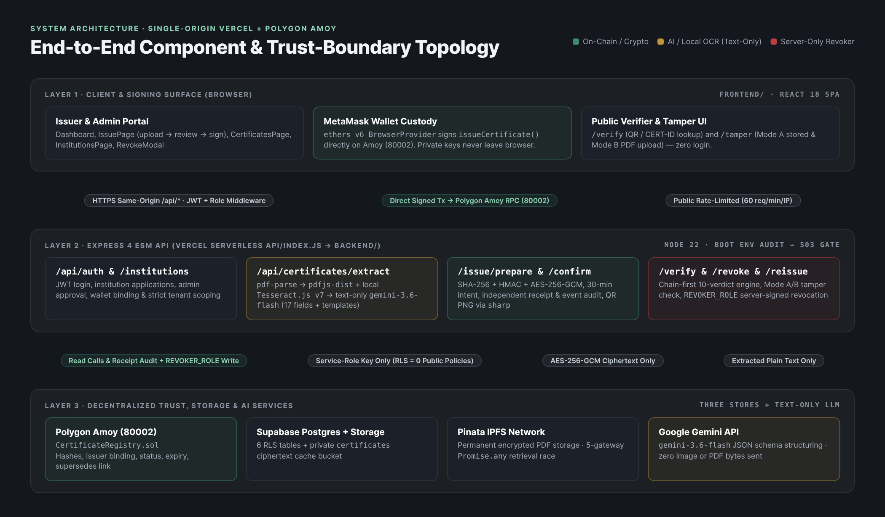
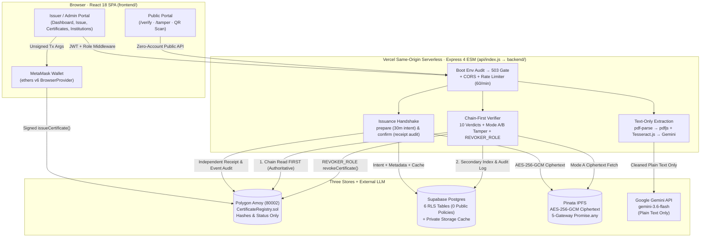
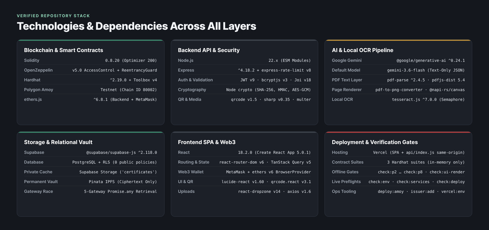
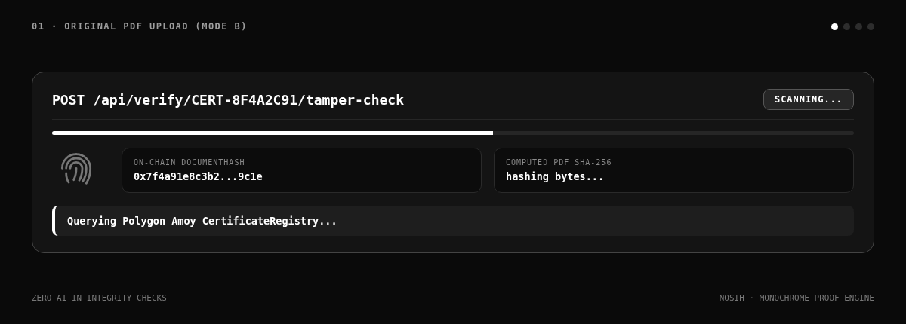
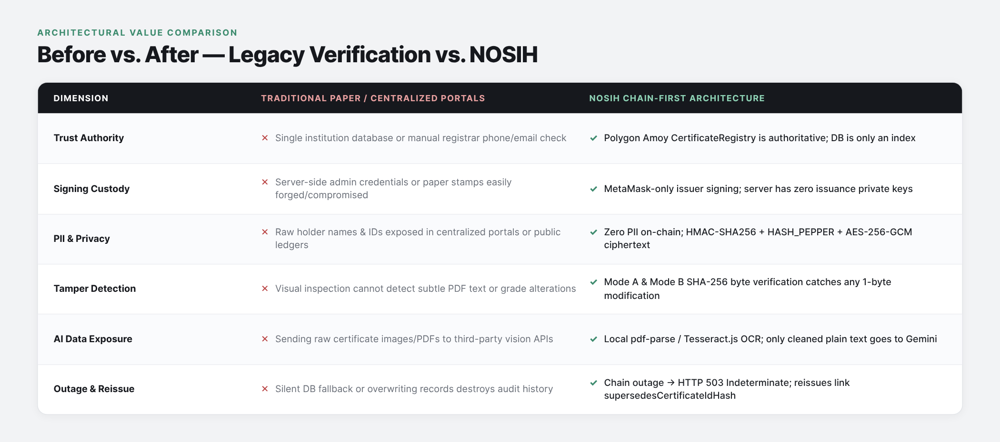

<div align="center">

<a name="readme-top"></a>


# NOSIH


**Decentralized certificate authentication for academic and professional credentials.**<br />
Institutions issue tamper-evident certificates signed directly via MetaMask; anyone verifies them against the Polygon Amoy blockchain — **no account required**.

<p>
  
  
  
  
  
  
  
</p>

<p>
  <a href="#02-what-is-nosih">Overview</a> ·
  <a href="#03-the-problem">Problem</a> ·
  <a href="#05-key-features">Features</a> ·
  <a href="#06-system-architecture">Architecture</a> ·
  <a href="#07-how-it-works">Pipeline</a> ·
  <a href="#08-technology-stack">Tech Stack</a> ·
  <a href="#10-installation-and-setup">Quick Start</a> ·
  <a href="#11-usage-guide">API &amp; Usage</a> ·
  <a href="#13-performance-testing-and-verification-gates">Gates</a> ·
  <a href="#15-roadmap">Roadmap</a> ·
  <a href="#18-faq">FAQ</a>
</p>

<br />



</div>

<br />

<details>
<summary><strong>Table of Contents</strong> — Click to expand full navigation</summary>

1. [What Is NOSIH?](#02-what-is-nosih)
2. [The Problem](#03-the-problem)
3. [Our Approach &amp; Cryptographic Design](#04-our-approach)
4. [Key Implemented Features](#05-key-features)
5. [System Architecture](#06-system-architecture)
6. [How It Works — End-to-End Pipeline](#07-how-it-works)
7. [Technology Stack](#08-technology-stack)
8. [Project Structure](#09-project-structure)
9. [Installation and Setup](#10-installation-and-setup)
10. [Usage Guide &amp; API Surface](#11-usage-guide)
11. [Visual Demonstration](#12-visual-demonstration)
12. [Performance, Testing &amp; Verification Gates](#13-performance-testing-and-verification-gates)
13. [Before vs. After](#14-before-vs-after)
14. [Roadmap &amp; Milestones](#15-roadmap)
15. [Research, Architecture Docs &amp; References](#16-research-and-references)
16. [Known Limitations](#17-limitations)
17. [Frequently Asked Questions](#18-faq)
18. [Contributing](#19-contributing)
19. [License](#20-license)
20. [Acknowledgements](#21-acknowledgements)

</details>

<p align="center"></p>

## 02. What Is NOSIH?

**NOSIH** is a chain-first decentralized credential issuance, verification, and tamper-detection platform for academic degrees, diplomas, transcripts, professional certifications, and institutional credentials.

In NOSIH, **the blockchain is the sole authority**: a certificate is authentic only when its on-chain record in `CertificateRegistry.sol` on **Polygon Amoy (`chainId: 80002`)** matches the approved document bytes and canonical metadata, its issuer wallet is cryptographically bound to an approved institution, and the record is neither revoked nor expired. The relational database (Supabase Postgres) serves strictly as a secondary metadata index, and Pinata IPFS stores only AES-256-GCM encrypted ciphertext.

<div align="center">
  
</div>

### Verified Architecture Snapshot

| Metric | Value | Source in Repository |
| :--- | :--- | :--- |
| **On-Chain PII Fields** | **0** (hashes, CID &amp; lifecycle flags only) | `contracts/CertificateRegistry.sol` |
| **Verification Verdicts** | **10** explicit chain-authoritative states | `backend/services/verification.js` |
| **Tamper-Check Modes** | **2** (Mode A stored ciphertext · Mode B PDF upload) | `backend/routes/verify.js` |
| **AI Extraction Schema** | **17** base fields + **10** category templates | `backend/services/certificateTemplates.js` |
| **RLS-Locked Tables** | **6** Postgres tables (`0` public policies) | `backend/supabase/schema.sql` |
| **Cryptographic Primitives** | **3** hash families + **AES-256-GCM** | `backend/services/certificateIdentity.js` |
| **Verification Test Suites** | **3** Hardhat suites + **17** npm check gates | `test/` &amp; `package.json` |
| **Deployed Testnet Contract** | `0xA9334Eb5E1c2811dcAE32880702092a7A7555680` | `deployments/amoy.json` (Amoy `80002`) |

<p align="center"></p>

## 03. The Problem

Academic and professional credentials remain high-value targets for forgery, silent grade manipulation, and institutional impersonation. Existing verification systems fail along five structural axes:

- **Easily Forged Paper &amp; Unverified PDFs**: Stamps, signatures, and digital PDFs can be altered in seconds without leaving any visual artifact detectable by an employer or admissions officer.
- **Centralized Single Points of Trust**: Traditional institutional portals rely on a single database and admin login. If a database row is silently altered or an admin account is compromised, verifiers receive a false positive.
- **Server-Side Key Custody Risk**: Platforms that hold an `ISSUER_PRIVATE_KEY` on a backend server collapse institutional accountability — a single server compromise allows arbitrary forged issuances.
- **Public Ledger Privacy Leaks**: Naive blockchain credential systems write student names, roll numbers, or raw PDFs on-chain or to public IPFS, permanently exposing personally identifiable information (PII).
- **Third-Party AI Data Exposure**: Uploading raw certificate images or base64 PDFs to external vision LLMs leaks sensitive identity documents outside the issuer's security boundary.

<p align="center"></p>

## 04. Our Approach

NOSIH resolves these trade-offs through **strict separation of duties across three stores**, **non-custodial issuer signing**, and **fail-closed verification**:

1. **Three Stores, Three Jobs**
   - **Polygon Amoy (`CertificateRegistry.sol`)**: Anchors keyed hashes (`certificateIdHash`, `institutionIdHash`, `holderIdentityHash`, `documentHash`, `metadataHash`, `revocationReasonHash`), encrypted `ipfsCID`, issuer address (`msg.sender`), timestamps (`issuedAt`, `expiresAt`), `revoked` flag, and `supersedesCertificateIdHash`.
   - **Pinata IPFS + Supabase Private Storage Mirror**: Stores AES-256-GCM encrypted PDF ciphertext only. Reads check the private `certificates` bucket first and fall back to a 5-gateway `Promise.any` IPFS race (Pinata, `ipfs.io`, `dweb.link`, etc.) with background cache backfill.
   - **Supabase Postgres (RLS Enabled, Zero Public Policies)**: Indexes institutions, staff users, bound wallets, approved metadata, 30-minute issuance intents, and private audit/revocation logs. Reachable exclusively through the backend's `SUPABASE_SERVICE_ROLE_KEY`.
2. **Non-Custodial Issuance, Scoped Revocation**
   - Issuance is signed **exclusively by the issuer's MetaMask wallet** (`ethers` v6 `BrowserProvider`). Each issuer wallet is bound on-chain to exactly one `institutionIdHash` (`issuerInstitution[msg.sender]`), preventing cross-institution issuance at the EVM level.
   - Revocation is the **only server-side chain write**, executed via a dedicated `REVOKE_PRIVATE_KEY` holding `REVOKER_ROLE`. The human-readable reason remains private in `certificate_events`, while only its peppered HMAC hash is recorded on-chain.
3. **Human-in-the-Loop, Text-Only AI Extraction**
   - Digital PDFs are parsed locally via `pdf-parse`; scanned PDFs are rendered and OCR'd locally via `Tesseract.js v7`. Only cleaned plain text is sent to Google Gemini (`gemini-3.6-flash`), which pre-fills the review form. Every field requires explicit human approval before hashing or signing.

### Implementation Status Transparency

| Status | Scope in This Repository |
| :--- | :--- |
| **Implemented &amp; Verified** | `CertificateRegistry.sol` (deployed on Polygon Amoy), MetaMask `prepare → sign → confirm` handshake, 10-verdict chain-first public verifier, Mode A &amp; Mode B tamper checks, text-only PDF/OCR → Gemini extraction, 6-table RLS schema &amp; additive migration, RBAC (`platform_admin`, `institution_admin`, `issuer`, `auditor`, `public`), revocation &amp; supersede reissuance, QR PNG generation, Vercel same-origin wiring, 3 Hardhat suites, and `check:p2`–`check:p8` gates. |
| **In Progress / Operational** | Automated GitHub Actions CI workflows, adding an explicit root `LICENSE` file, retiring legacy land-deed presentation/helper scripts (`verify-deployment-ready.mjs`), and live production Vercel promotion. |
| **Planned** | Scheduled Pinata unpin job for expired/abandoned issuance intents, pluggable secondary OCR engines via `registerOcrEngine()`, batch cohort issuance, and Polygon Mainnet (`137`) / enterprise permissioned chain rollout. |

<p align="center"></p>

## 05. Key Features

<div align="center">
  
</div>

### 1. MetaMask-Only Issuance Handshake (`prepare → sign → confirm`)
- **How it works**: `POST /api/certificates/issue/prepare` validates JWT auth, institution approval, active bound wallet, PDF magic bytes/size/page count, and duplicate guards, then computes hashes, encrypts &amp; pins the PDF, and writes a 30-minute `issuance_intents` row. The browser signs `issueCertificate` in MetaMask, and `POST /api/certificates/issue/confirm` independently verifies the on-chain receipt (`status === 1`, `to === CONTRACT_ADDRESS`, `chainId === 80002`) and every `CertificateIssued` event field against the intent before committing the authoritative certificate row.
- **Why it matters**: Eliminates server-side issuance key theft and makes confirmation idempotent and retry-safe (returning HTTP `202` while a transaction is pending).

### 2. Chain-First Public Verification (10 Explicit Verdicts)
- **How it works**: `GET /api/verify/:certificateId` (public, rate-limited at 60 req/min/IP) queries `CertificateRegistry` on Polygon Amoy first, cross-checks Supabase metadata, and computes one of 10 explicit verdicts — including `blockchain-unavailable` (HTTP `503`, Indeterminate) whenever the RPC is unreachable.
- **Why it matters**: A database row alone can never certify a credential, and verifiers never need to create an account.

### 3. Dual-Mode Cryptographic Tamper Detection
- **How it works**: `POST /api/verify/:certificateId/tamper-check` supports **Mode A** (no file upload: fetches encrypted ciphertext from cache/IPFS, decrypts in memory, re-hashes against the chain without exposing PDF contents) and **Mode B** (PDF upload: validates magic bytes and hashes the exact uploaded bytes against the on-chain `documentHash`).
- **Why it matters**: Detects even a 1-byte modification deterministically with zero AI in the integrity path.

### 4. Privacy-First Text-Only AI Extraction
- **How it works**: `pdfParser.js` extracts the JavaScript text layer (`PDF_TEXT_MIN_CHARS = 200`, `MAX_PDF_PAGES = 10`). If insufficient, pages render via `pdfjs-dist` + `pdf-to-png-converter` + `sharp` and run local `Tesseract.js v7` OCR behind a concurrency semaphore. `gemini.js` accepts strings only — image and PDF parts cannot be transmitted even by accident.
- **Why it matters**: Cuts manual registrar typing across 17 base fields and 10 credential templates while keeping raw document pixels strictly inside the server boundary.

### 5. Three-Family Cryptography &amp; Zero-PII Ledger
- **How it works**: Low-entropy PII (`holderIdentityHash`, `institutionIdHash`, `revocationReasonHash`) uses `HMAC-SHA256` with server-side `HASH_PEPPER`; random IDs (`CERT-XXXXXXXX`, `INST-XXXXXXXX`) map to `bytes32` via `keccak256`; exact PDF bytes and canonical JSON use `SHA-256`; PDFs use `AES-256-GCM` with `DOCUMENT_ENC_KEY`.
- **Why it matters**: Prevents dictionary brute-forcing of holder identities from public blockchain state and protects stored PDFs even on public IPFS gateways.

### 6. Auditable Revocation &amp; Non-Destructive Reissuance
- **How it works**: `platform_admin` or the owning `institution_admin` revokes via `RevokeModal` with a mandatory reason (`REVOKER_ROLE` writes `revocationReasonHash` on-chain; plaintext reason stays in `certificate_events`). Reissuance (`POST /api/certificates/:certificateId/reissue`) prefills a new issuance intent linking `supersedesCertificateIdHash` to the prior record without mutating history.
- **Why it matters**: Preserves a complete, immutable audit trail when correcting errors or revoking compromised credentials.

### Role-Based Access Control Matrix

| Role | Scope &amp; Verified Capabilities |
| :--- | :--- |
| `platform_admin` | Approve, reject, or suspend institutions; manage any institution's staff and issuer wallets; revoke any certificate |
| `institution_admin` | Manage own institution profile, wallets, and staff; issue, revoke, and reissue own institution's certificates |
| `issuer` | Issue and reissue certificates for their own approved institution using their bound MetaMask wallet |
| `auditor` | Read-only access to their own institution's certificates and audit history |
| `public` | Verify any certificate by `CERT-XXXXXXXX` ID or QR code and run Mode A / Mode B tamper checks — no login |

<p align="center"></p>

## 06. System Architecture

<div align="center">
  
</div>

### Component Interaction Flow (Mermaid)



<p align="center"></p>

## 07. How It Works

<div align="center">
  
</div>

### Stage-by-Stage Issuance &amp; Verification Pipeline

1. **PDF Upload &amp; Validation**: The issuer uploads a PDF (`MAX_UPLOAD_MB = 4` default on Vercel, `MAX_PDF_PAGES = 10`). Magic bytes (`%PDF-`) and size bounds are verified server-side.
2. **Local Text-Layer or OCR Extraction**: `pdf-parse` extracts embedded text first (`PDF_TEXT_MIN_CHARS = 200`). If the PDF is scanned, `pdfjs-dist` + `pdf-to-png-converter` + `sharp` render pages and `Tesseract.js v7` performs local OCR behind a concurrency semaphore.
3. **Text-Only AI Structuring**: Cleaned plain text is sent to `gemini-3.6-flash` with a strict JSON `responseSchema` derived from `certificateTemplates.js` to extract 17 base fields plus category-specific extras, confidence scores, and stated-vs-inferred flags.
4. **Mandatory Human Review**: The issuer inspects the extracted fields side-by-side with the PDF preview, corrects any value, and explicitly approves the payload.
5. **Cryptographic Preparation &amp; Encrypted Pinning (`POST /api/certificates/issue/prepare`)**: The backend checks institution approval, bound wallet status, and duplicate guards; generates `CERT-XXXXXXXX`, `SHA-256` document/metadata hashes, and `HMAC-SHA256` identity hashes; encrypts the PDF with `AES-256-GCM`; pins ciphertext to Pinata IPFS (and mirrors to Supabase private storage); and creates a 30-minute `issuance_intents` record.
6. **MetaMask On-Chain Signing**: The frontend switches/verifies Polygon Amoy (`80002`), confirms the connected MetaMask account matches the intent's `issuerWallet`, and signs `issueCertificate(...)` directly from the browser.
7. **Independent Receipt Verification &amp; QR Issuance (`POST /api/certificates/issue/confirm`)**: The backend queries the transaction receipt directly on-chain, validates status, target contract, chain ID, and every `CertificateIssued` event field against the stored intent, inserts the authoritative `certificates` row, and renders a labeled QR PNG encoding `/verify?certificateId=CERT-XXXXXXXX`.
8. **Zero-Account Chain-First Verification**: Anyone scans the QR code or visits `/verify` or `/tamper` to validate authenticity, revocation, expiry, supersede lineage, or exact PDF byte integrity directly against Polygon Amoy.

<details>
<summary><strong>Deep Dive: All 10 Chain-Authoritative Verification Verdicts</strong></summary>

| Verdict Key | Display Label | HTTP Status | Meaning |
| :--- | :--- | :---: | :--- |
| `authentic-active` | Authentic and Active | `200` | On-chain record exists, matches DB &amp; hashes, issuer authorized, not revoked/expired/superseded |
| `revoked` | Certificate Revoked | `200` | On-chain `revoked === true` (overrides hash match) |
| `expired` | Certificate Expired | `200` | On-chain `expiresAt !== 0 && now > expiresAt` (lazily mirrored to DB) |
| `superseded` | Certificate Superseded (Reissued) | `200` | Replaced by a newer certificate; response includes the replacement `CERT-XXXXXXXX` ID |
| `document-mismatch` | Document Hash Mismatch | `200` | Document hash diverges from the immutable on-chain `documentHash` |
| `metadata-mismatch` | Metadata Mismatch | `200` | Approved metadata hash diverges from on-chain `metadataHash` |
| `issuer-unauthorized` | Issuer Unauthorized | `200` | Issuer wallet or institution binding does not match on-chain authorization |
| `not-found` | Certificate Not Found | `404` | No record found on-chain for the supplied valid `CERT-XXXXXXXX` ID |
| `db-chain-mismatch` | Database/Blockchain Mismatch | `200` | Record exists on-chain but is missing or structurally inconsistent in Supabase |
| `blockchain-unavailable` | Blockchain Unavailable — Indeterminate | `503` | Polygon Amoy RPC unreachable; fails closed and never falls back to DB-only validation |

</details>

<details>
<summary><strong>Deep Dive: 17 Base Extracted Fields &amp; 10 Supported Certificate Categories</strong></summary>

- **17 Base Fields (`backend/services/certificateTemplates.js`)**: `certificateType`, `certificateNumber`, `holderName`, `holderIdentifier`, `institutionName`, `institutionAddress`, `courseName`, `qualification`, `qualificationLevel`, `specialization`, `grade`, `percentage`, `issueDate`, `expiryDate`, `academicYear`, `signatoryName`, `signatoryDesignation`.
- **10 Certificate Categories with Dynamic Extra Templates** (stored in `certificates.extra_data` JSONB): `undergraduate_degree`, `postgraduate_degree`, `diploma`, `transcript`, `professional_training`, `technical_certification`, `course_completion`, `internship`, `achievement`, `other`.

</details>

<p align="center"></p>

## 08. Technology Stack

<div align="center">
  
</div>

| Layer | Technologies &amp; Verified Versions |
| :--- | :--- |
| **Smart Contracts &amp; Web3** | Solidity `0.8.20` (optimizer 200 runs), `@openzeppelin/contracts` `^5.0.0` (`AccessControl`, `ReentrancyGuard`), `hardhat` `^2.19.0`, `@nomicfoundation/hardhat-toolbox` `^4.0.0`, `ethers` `^6.8.1`, Polygon Amoy (`80002`) |
| **Backend API &amp; Security** | Node.js `22.x` (ESM), `express` `^4.18.2`, `express-rate-limit` `^8.7.4`, `jsonwebtoken` `^9.0.2`, `bcryptjs` `^3.0.3`, `joi` `^18.0.2`, `cors` `^2.8.5`, `multer` `^1.4.5-lts.1`, `qrcode` `^1.5.3`, `sharp` `^0.35.2` |
| **AI &amp; Local OCR Pipeline** | `@google/generative-ai` `^0.24.1` (`gemini-3.6-flash` default, text-only), `pdf-parse` `^2.4.5`, `pdfjs-dist` `5.4.296`, `pdf-to-png-converter` `^3.11.0`, `@napi-rs/canvas` `^1.1.0`, `tesseract.js` `^7.0.0` |
| **Database &amp; Storage** | `@supabase/supabase-js` `^2.118.0` (PostgreSQL + RLS + private Storage bucket `certificates`), Pinata IPFS + 5-gateway `Promise.any` race |
| **Frontend SPA** | `react` `18.2.0`, `react-scripts` `5.0.1`, `react-router-dom` `^6.20.1`, `@tanstack/react-query` `^5.8.4`, `ethers` `^6.8.1`, `lucide-react` `^1.60.0`, `qrcode.react` `^3.1.0`, `react-dropzone` `^14.2.3`, `axios` `^1.6.2` |
| **Deployment &amp; Tooling** | Vercel (`vercel.json` SPA + `api/index.js` serverless rewrite), custom Node `.mjs`/`.js` preflight &amp; verification scripts |

<p align="center"></p>

## 09. Project Structure

```text
NOSIH-CERT-main/
├── api/
│   ├── index.js                         # Vercel serverless entry wrapping backend/server.js
│   └── package.json
├── assets/
│   └── readme/                          # Custom README infographics, SVGs, logo & animated GIFs
├── backend/
│   ├── server.js                        # Express 4 ESM app, /api/health, boot env audit → 503 gate
│   ├── config.js · env.js · envCheck.js # Root .env loader & startup configuration validator
│   ├── supabase.js                      # Service-role Supabase client
│   ├── middleware/                      # auth.js, errorHandler.js, institutionAccess.js, issuerAccess.js
│   ├── routes/                          # auth.js, institutions.js, certificates.js, verify.js
│   ├── services/                        # blockchain, certificateExtraction, certificateIdentity,
│   │                                    # certificateStorage, certificateTemplates, gemini, ipfs,
│   │                                    # ocr, pdfParser, canvasIcu, qr, verification, ABI
│   ├── supabase/
│   │   ├── schema.sql                   # Fresh-install 6-table RLS schema
│   │   └── migrations/001_nosih.sql     # Additive, idempotent migration preserving legacy tables
│   └── scripts/                         # Offline gates (checkP2…checkP9), seedAdmin, smokeP2, fixtures
├── contracts/
│   └── CertificateRegistry.sol          # Solidity 0.8.20 OpenZeppelin AccessControl + ReentrancyGuard
├── deployments/
│   └── amoy.json                        # Deployed Polygon Amoy contract address, txHash & roles
├── frontend/
│   ├── public/                          # index.html, nosih-logo.svg
│   └── src/
│       ├── assets/                      # Official nosih-logo.png & nosih-logo.svg
│       ├── components/                  # WalletConnect, CertificateUpload, CertificatePreview,
│       │                                # VerificationResult, QRDisplay, RevokeModal, TransactionStatus, etc.
│       ├── pages/                       # Login, Dashboard, Issue, Certificates, CertificateDetails,
│       │                                # Institutions, Verify, Tamper + styles.css design tokens
│       ├── services/                    # wallet.js (MetaMask), contract.js
│       └── utils/                       # api.js, certificateHelpers.js, contractABI.js
├── images/badges/                       # Existing SVG status badges
├── plan/                                # Migration plan, architecture, solution design & strategy docs
├── scripts/                             # deploy, addIssuer, removeIssuer, generateAbi, check-*, vercel-*
├── test/                                # CertificateRegistry, IssuanceHandshake & Verification Hardhat suites
├── vercel/                              # Vercel deployment troubleshooting & setup notes
├── hardhat.config.js                    # Solidity 0.8.20, hardhat/localhost/amoy/polygon networks
├── vercel.json                          # Same-origin frontend build + /api/* serverless rewrite
├── .env.example                         # Annotated root environment template
└── package.json                         # Root scripts for contracts, gates & Vercel ops
```

<p align="center"></p>

## 10. Installation and Setup

### Prerequisites

- **Node.js `22.x`** and `npm`
- A **Supabase** project (PostgreSQL + Storage)
- A **Pinata** account (JWT or API keys for IPFS pinning)
- A **Google Gemini API key** (for text-only structured extraction)
- **MetaMask** browser extension configured for **Polygon Amoy (`chainId: 80002`)** with test POL for deployer, issuer, and revoker wallets

### Local Setup

```bash
# 1. Install dependencies across root (Hardhat), backend, and frontend
npm install
npm install --prefix backend
npm install --prefix frontend

# 2. Configure root environment variables (see annotated .env.example)
cp .env.example .env

# 3. Optional frontend environment (frontend/.env.local)
cp frontend/env.example frontend/.env.local
```

### Database, Contract &amp; Services Bootstrap

1. **Apply Database Schema**
   - *Fresh Supabase project*: run `backend/supabase/schema.sql` in the Supabase SQL Editor (or `npm run schema:apply`).
   - *Existing NOSIH project*: run `backend/supabase/migrations/001_nosih.sql` (additive &amp; idempotent — preserves prior tables; take a backup first).
2. **Seed Platform Admin**
   ```bash
   npm run seed:admin
   ```
3. **Deploy `CertificateRegistry` to Polygon Amoy** *(live write — requires funded deployer)*
   ```bash
   npm run deploy:amoy -- --yes
   ```
   Grants `REVOKER_ROLE`, writes `deployments/amoy.json`, regenerates both ABI modules (`backend/services/certificateRegistryABI.js` and `frontend/src/utils/contractABI.js`), and updates `CONTRACT_ADDRESS`.
4. **Approve Institution &amp; Authorize Issuer Wallet On-Chain**
   - Sign in as `platform_admin`, register or approve the institution, and add its issuer wallet address.
   - Authorize the wallet on-chain (also activates the `issuer_wallets` row):
   ```bash
   npm run issuer:add -- --yes
   ```
5. **Run Backend &amp; Frontend Locally**
   ```bash
   # Terminal 1 — Express API on port 5000
   npm --prefix backend run dev

   # Terminal 2 — React SPA on port 3000 (proxies /api → localhost:5000)
   npm --prefix frontend start
   ```

<details>
<summary><strong>Environment Variable Reference &amp; Vercel Deployment</strong></summary>

#### Required at Boot (`backend/envCheck.js`)
| Variable | Purpose |
| :--- | :--- |
| `SUPABASE_URL` | Project URL (`https://<ref>.supabase.co`) |
| `SUPABASE_SERVICE_ROLE_KEY` | Secret service-role key (publishable key cannot read RLS-locked tables) |
| `JWT_SECRET` | Random secret (≥16 chars) signing session JWTs |
| `DOCUMENT_ENC_KEY` | 64-hex-char (32-byte) AES-256-GCM encryption key — **back up securely** |
| `HASH_PEPPER` | 64-hex-char (32-byte) HMAC-SHA256 pepper — **back up securely** |

#### Chain &amp; Feature-Gated Variables
- `CONTRACT_ADDRESS` — required for all chain reads and receipt verification
- `GEMINI_API_KEY` (and optional `GEMINI_MODEL`, default `gemini-3.6-flash`) — AI extraction
- `PINATA_JWT` — IPFS ciphertext pinning during issuance
- `REVOKE_PRIVATE_KEY` — server-side `REVOKER_ROLE` signer (revocation only; there is no `ISSUER_PRIVATE_KEY`)

#### Deploying to Vercel
`REACT_APP_*` variables are inlined at **build time** and must be pushed before deploying:
```bash
vercel login
npm run vercel:env        # pushes backend + REACT_APP_* vars (supports --dry-run)
npm run check:deploy      # full preflight: env, live credentials, native-module trace
npm run vercel:deploy
```

</details>

<p align="center"></p>

## 11. Usage Guide

### Public Chain-First Verification (No Account Required)

```bash
# Verify a certificate by its human-readable CERT ID
curl -s https://<your-domain>/api/verify/CERT-8F4A2C91 | jq

# Mode A tamper check (re-hashes stored encrypted IPFS/cache PDF without exposing file bytes)
curl -s -X POST https://<your-domain>/api/verify/CERT-8F4A2C91/tamper-check | jq

# Mode B tamper check (hashes an uploaded PDF's exact bytes against the on-chain documentHash)
curl -s -X POST https://<your-domain>/api/verify/CERT-8F4A2C91/tamper-check \
  -F "file=@./candidate_degree.pdf" | jq

# Check backend health & configuration audit (always answers even if misconfigured)
curl -s http://localhost:5000/api/health | jq
```

<details>
<summary><strong>Complete Verified REST API Surface</strong></summary>

| Group | Method &amp; Endpoint | Access | Description |
| :--- | :--- | :--- | :--- |
| **Health** | `GET /api/health` | Public | Boot env audit &amp; Supabase readiness (`200` ok / `503` degraded) |
| **Auth** | `POST /api/auth/login` · `POST /api/auth/register` | Public / Admin | Session login &amp; admin user provisioning |
| **Auth** | `GET /api/auth/me` · `PATCH /api/auth/me/wallet` | Authenticated | Current profile &amp; wallet association |
| **Institutions** | `POST /api/institutions/apply` | Public | Public institution onboarding application |
| **Institutions** | `GET /api/institutions` · `GET /mine` · `GET /:id` · `PATCH /:id` | Role-Scoped | Institution directory &amp; profile updates |
| **Institutions** | `PATCH /api/institutions/:id/status` | `platform_admin` | Approve, reject, or suspend an institution |
| **Institutions** | `GET/POST/PATCH /api/institutions/:id/wallets` &amp; `/users` | Admin-Scoped | Manage bound issuer wallets and institution staff |
| **Certificates** | `POST /api/certificates/extract` · `GET /meta/templates` | Issuer / Admin | Text-only PDF/OCR → Gemini extraction &amp; template catalog |
| **Certificates** | `POST /api/certificates/issue/prepare` · `POST /issue/confirm` | Issuer / Admin | Two-phase MetaMask issuance handshake + `GET /issue/intents/:id` |
| **Certificates** | `GET /api/certificates` · `GET /:id` · `GET /:id/document` · `GET /:id/qr` | Role-Scoped | List, inspect, decrypt PDF, or fetch labeled QR PNG |
| **Certificates** | `POST /api/certificates/:id/revoke` · `POST /:id/reissue` | Admin / Issuer | Permanent on-chain revocation &amp; supersede reissuance |
| **Public Verify** | `GET /api/verify/:id` · `POST /:id/tamper-check` · `GET /:id/qr` | Public (60/min) | Chain-authoritative verification, Mode A/B tamper check &amp; QR PNG |

</details>

<p align="center"></p>

## 12. Visual Demonstration

### Animated Cryptographic Tamper Detection Walkthrough

<div align="center">
  
</div>

### Live Testnet Deployment Coordinates (`deployments/amoy.json`)

| Artifact | Verified Value |
| :--- | :--- |
| **Network** | Polygon Amoy Testnet (`chainId: 80002`) |
| **Contract** | `CertificateRegistry` — [`0xA9334Eb5E1c2811dcAE32880702092a7A7555680`](https://amoy.polygonscan.com/address/0xA9334Eb5E1c2811dcAE32880702092a7A7555680) |
| **Deployment Tx** | [`0x86b5cfb857e10e7347538e5eb24d08149b42b9ea37ba80b5b50b95997d8b3dc8`](https://amoy.polygonscan.com/tx/0x86b5cfb857e10e7347538e5eb24d08149b42b9ea37ba80b5b50b95997d8b3dc8) |
| **Deployed At** | `2026-11-19T05:16:22.365Z` |

<p align="center"></p>

## 13. Performance, Testing and Verification Gates

No GitHub Actions CI workflows are configured yet; instead, NOSIH ships an extensive suite of **in-memory Hardhat tests** and **local preflight verification gates**.

> **Standing Rule — Zero Live Ledger Writes in Tests:** All smart-contract and integration tests run exclusively on Hardhat's in-memory EVM. Live Polygon Amoy writes (`deploy:amoy`, `issuer:add`, `issuer:remove`) execute only with explicit `--yes` approval and funded wallets.

### Automated Test Suites (`npm test`)

| Suite | File | Verified Coverage |
| :--- | :--- | :--- |
| **Smart Contract** | `test/CertificateRegistry.test.js` | 14 tests covering `DEFAULT_ADMIN_ROLE`, institution-bound `ISSUER_ROLE`, duplicate rejection, cross-institution blocking, `REVOKER_ROLE` once-only revocation, supersede reissuance, expiry guards, and event emissions |
| **Issuance Handshake** | `test/IssuanceHandshake.test.js` | 14 tests verifying receipt status/contract/chain checks, event-vs-intent tamper rejection, pending tx handling, malformed hash rejection, `ChainConfigError`/`ChainUnavailableError`, and absence of server-side issuance keys |
| **Chain-First Verifier** | `test/Verification.test.js` | 16+ tests exercising all 10 verdicts, `503` fail-closed outage behavior, Mode A ciphertext integrity, Mode B 1-byte modification detection, revocation-over-hash-match, and malformed ID rejection |

### Local Verification Gates

| Command | Mode | What It Verifies |
| :--- | :---: | :--- |
| `npm test` | Offline | Full Hardhat in-memory contract, handshake &amp; verification suites |
| `npm run check:p2` … `check:p8` | Offline | Schema/authz, extraction, storage/QR, handshake, verification/revocation, frontend contract alignment |
| `npm run check:ui-render` | Offline | Production React bundle renders readable failures in jsdom (no blank white screen) |
| `npm run check:boot` | Offline | Misconfigured boot stays alive and reports every missing variable via `/api/health` |
| `npm run check:env` | Live Read-Only | Env audit, key/address derivation, frontend config, RPC connectivity &amp; balances |
| `npm run check:gas` | Live Read-Only | Wallet POL credit report (nothing broadcast) |
| `npm run check:services` | Live Read-Only | Real read-only credential checks against Supabase, Gemini, and Pinata |
| `npm run check:jwt` / `check:ipfs` | Live | Pinata JWT scope audit and 1-byte pin + fetch roundtrip |
| `npm run check:extract` | Live | Real Gemini text-only extraction on digital + scanned certificate fixtures |
| `npm run check:deploy` | Live Preflight | Full Vercel preflight including native-module (`@napi-rs/canvas`, `sharp`, `pdfjs-dist`) file trace |
| `npm run smoke:api` | Live | End-to-end HTTP authorization flow (requires applied migration + seeded admin) |

<p align="center"></p>

## 14. Before vs. After

<div align="center">
  
</div>

<p align="center"></p>

## 15. Roadmap

<div align="center">
  
</div>

<details>
<summary><strong>Development Milestones (Migration Phases P0–P9)</strong></summary>

- **P0–P1 · Audit &amp; Architecture Plan**: Full codebase audit and design blueprint (`plan/CERTICHAIN_MIGRATION_PLAN.md`).
- **P2 · Schema &amp; Authorization**: 6-table RLS schema, additive migration `001_nosih.sql`, and multi-role institution/wallet middleware.
- **P3 · Smart Contract**: `CertificateRegistry.sol` (Solidity `0.8.20`, OpenZeppelin v5) with 14-test Hardhat suite.
- **P4–P5 · Text-Only AI Extraction &amp; Crypto Vault**: Split `pdfParser` + local `Tesseract.js` + text-only `gemini.js`, three-family hashing, AES-256-GCM encryption, Pinata IPFS + Supabase mirror, and labeled QR PNGs.
- **P6–P7 · MetaMask Handshake &amp; 10-Verdict Verifier**: `prepare → sign → confirm` flow, chain-first verifier, Mode A/B tamper checks, `REVOKER_ROLE`, and supersede reissuance.
- **P8–P9 · Frontend SPA &amp; Amoy Deployment**: React 18 portal (`IssuePage`, `VerifyPage`, `TamperPage`, `InstitutionsPage`, `RevokeModal`) and live Polygon Amoy deployment (`2026-11-19`).

</details>

<p align="center"></p>

## 16. Research and References

### Repository Design &amp; Architecture Documents
- [`plan/CERTICHAIN_MIGRATION_PLAN.md`](plan/CERTICHAIN_MIGRATION_PLAN.md) — Complete engineering specification covering D1–D10 design decisions and P0–P9 verification gates.
- [`plan/TECHNICAL_ARCHITECTURE.md`](plan/TECHNICAL_ARCHITECTURE.md) — Three-tier cryptographic storage and failure-mode architecture reference.
- [`plan/SOLUTION_DESIGN.md`](plan/SOLUTION_DESIGN.md) — Three-family cryptographic design and continuous chain-of-custody concepts.
- [`plan/PROPOSED_TECHNOLOGIES.md`](plan/PROPOSED_TECHNOLOGIES.md) — Technology trade-off matrix and dependency rationale.
- [`NOSIH_presentation.pdf`](NOSIH_presentation.pdf) — *Historical note*: documents the earlier NOSIH land-deed prototype that established the three-tier cryptographic, IPFS, and RLS architecture later evolved into the current NOSIH-CERT academic/professional credential platform.

### External Standards &amp; Documentation
- [OpenZeppelin Contracts v5 — AccessControl &amp; ReentrancyGuard](https://docs.openzeppelin.com/contracts/5.x/access-control)
- [Polygon Amoy Testnet Documentation](https://docs.polygon.technology/)
- [Pinata IPFS Documentation](https://docs.pinata.cloud/)
- [Supabase Row-Level Security (RLS)](https://supabase.com/docs/guides/database/postgres/row-level-security)
- [NIST FIPS 180-4 (SHA-256) &amp; SP 800-38D (AES-GCM)](https://csrc.nist.gov/publications)

<p align="center"></p>

## 17. Limitations

- **Testnet Deployment**: Currently deployed on Polygon Amoy (`chainId: 80002`); production mainnet (`137`) or permissioned enterprise chain deployment requires separate RPC/funding configuration.
- **Orphaned Ciphertext on Abandoned Intents**: Because `/issue/prepare` encrypts and pins ciphertext before MetaMask signing, rejected or expired 30-minute intents leave unreferenced pins on Pinata until an automated unpin cleanup job is added.
- **Read-Time Expiry Semantics**: Smart contracts have no native cron; certificate expiry is computed on read (`expiresAt !== 0 && block.timestamp > expiresAt`) and lazily mirrored to Postgres.
- **Serverless Upload &amp; OCR Constraints**: Vercel enforces a 4.5 MB request body ceiling (`MAX_UPLOAD_MB` defaults to `4`, `MAX_PDF_PAGES` defaults to `10`), and local Tesseract.js OCR runs behind a single-worker concurrency semaphore to prevent per-page timeouts under load.
- **No Automated CI Yet**: Verification relies on local `npm test` and `check:p2`–`check:p8` scripts rather than GitHub Actions workflows.
- **Legacy Files Retained**: `NOSIH_presentation.pdf` and `verify-deployment-ready.mjs` remain in the repository from the prior land-deed phase (`scripts/vercel-preflight.mjs` is the active preflight script).

<p align="center"></p>

## 18. FAQ

<details>
<summary><strong>Why is there no server-side ISSUER_PRIVATE_KEY?</strong></summary>

By design, issuance is signed exclusively by the issuer's MetaMask wallet (`BrowserProvider`). Even if the backend server or database were compromised, an attacker cannot mint valid on-chain certificates for any institution.

</details>

<details>
<summary><strong>What happens if the Polygon Amoy RPC is down during verification?</strong></summary>

NOSIH fails closed and returns `blockchain-unavailable` with HTTP `503` (Indeterminate). It never falls back to reporting a certificate as valid from Supabase Postgres alone.

</details>

<details>
<summary><strong>Does NOSIH send certificate PDFs or images to Google Gemini?</strong></summary>

No. `backend/services/gemini.js` accepts strings only. Digital PDFs are parsed locally via `pdf-parse`, and scanned PDFs are OCR'd locally via `Tesseract.js v7`. Only cleaned plain text is sent to Gemini for JSON field structuring, and a human must review every field before signing.

</details>

<details>
<summary><strong>How does reissuance work if the blockchain is immutable?</strong></summary>

`CertificateRegistry.sol` never overwrites an existing certificate. Reissuance creates a new certificate ID whose `supersedesCertificateIdHash` points to the original record. Verifying the old ID returns `superseded` along with the replacement `CERT-XXXXXXXX` ID.

</details>

<details>
<summary><strong>What happens if DOCUMENT_ENC_KEY or HASH_PEPPER is lost?</strong></summary>

Losing `DOCUMENT_ENC_KEY` makes all previously encrypted IPFS/Supabase PDFs permanently undecryptable, and losing `HASH_PEPPER` breaks keyed identity and revocation-reason linkage. Back up both 64-hex-character keys securely outside the repository.

</details>

<p align="center"></p>

## 19. Contributing

Contributions that strengthen security, verification coverage, or documentation are welcome:

1. Fork the repository and create a feature branch (`git checkout -b feat/your-change`).
2. Install dependencies (`npm install`, `npm install --prefix backend`, `npm install --prefix frontend`).
3. Run the offline verification suites before opening a pull request:
   ```bash
   npm test
   npm run check:p2 && npm run check:p4 && npm run check:p5 && npm run check:p6 && npm run check:p7 && npm run check:p8
   ```
4. Never commit `.env` secrets or trigger live Polygon Amoy writes from automated tests.

<p align="center"></p>

## 20. License

- **Repository Root**: No `LICENSE` file is currently present in the repository root, and `package.json` omits a `"license"` field.
- **Smart Contract**: `contracts/CertificateRegistry.sol` specifies `// SPDX-License-Identifier: MIT`.

Until a root `LICENSE` file is added by the project maintainers, all rights outside the SPDX-tagged Solidity contract remain unspecified.

<p align="center"></p>

## 21. Acknowledgements

NOSIH builds on open-source cryptographic, Web3, OCR, and web foundations including [OpenZeppelin](https://www.openzeppelin.com/), [Hardhat](https://hardhat.org/), [ethers.js](https://docs.ethers.org/), [Polygon](https://polygon.technology/), [Supabase](https://supabase.com/), [Pinata / IPFS](https://www.pinata.cloud/), [Tesseract.js](https://tesseract.projectnaptha.com/), [PDF.js](https://mozilla.github.io/pdf.js/), [Google Gemini](https://ai.google.dev/), [React](https://react.dev/), [Express](https://expressjs.com/), and [Vercel](https://vercel.com/).

<br />

<div align="center">


<br />


**NOSIH** — *The chain is the authority. Zero PII on-chain. Zero-account public verification.*

<p>
  <a href="#readme-top">Back to Top ↑</a> ·
  <a href="#06-system-architecture">Architecture</a> ·
  <a href="#10-installation-and-setup">Quick Start</a> ·
  <a href="#13-performance-testing-and-verification-gates">Verification Gates</a> ·
  <a href="#18-faq">FAQ</a>
</p>

</div>